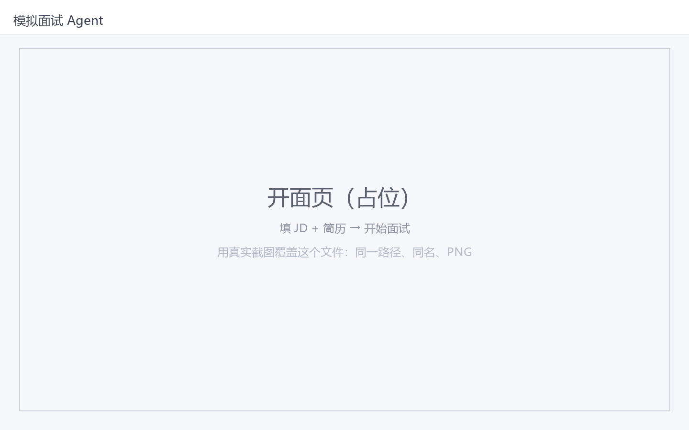
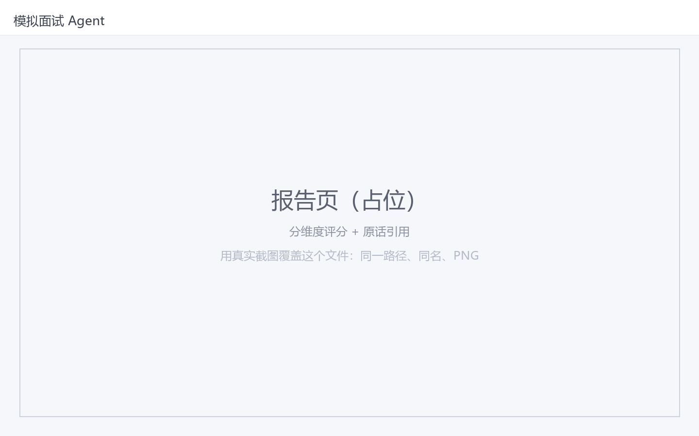
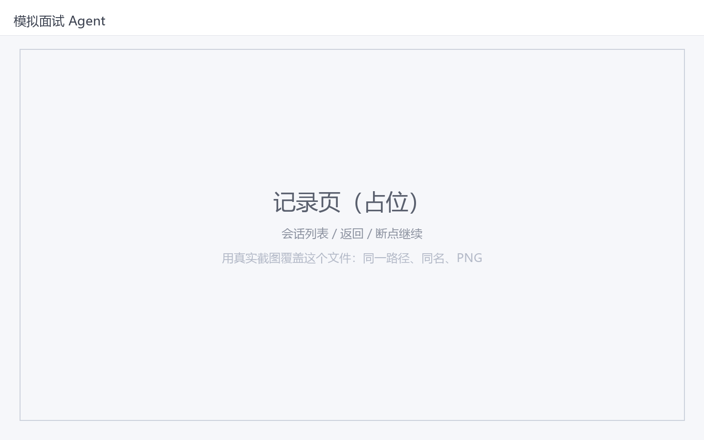

# 模拟面试 Agent

给一份岗位 JD 和一份简历，自动完成一场有追问的多轮模拟面试，最后产出一份**每个结论都能回溯到原话**的分维度评分报告。

```
JD + 简历 ──► 解析 ► 缺口匹配 ► 出题池 ► 提问 ─► 评分 ─► 决策 ─┐
                                    ▲                          │
                                    └──────── 追问 / 换维度 ◄────┘
                                                               ▼
                                                        分维度报告
```


特点：面试过程本身是一个 **LangGraph 状态机**（流程可控、可复现、可写单元测试），而「该不该追问、难度要不要升、下一题问哪个维度」这类判断交给 **agent**（模型带工具 + 结构化输出）来做。中间状态全部落 PostgreSQL，同一个会话随时可以中断、重启后接着问。

---

## 界面

截图取自仓库自带的样本数据（`data/`，全部为虚构内容）：

<table>
  <tr>
    <td></td>
    <td></td>
  </tr>
  <tr>
    <td align="center">开面页：填 JD 与简历，或从 PDF 上传</td>
    <td align="center">面试中：一次一问，支持追问与换维度</td>
  </tr>
  <tr>
    <td></td>
    <td></td>
  </tr>
  <tr>
    <td align="center">报告页：分维度评分，每条结论都带原话引用</td>
    <td align="center">记录页：历史会话、返回、断点继续</td>
  </tr>
</table>

## 能做什么

- 输入 JD 文本 + 简历文本，解析成结构化的岗位画像 / 候选人画像
- 自动做**缺口分析**：岗位要的技能，候选人是「有且对得上」「沾边但不熟」还是「完全没提」，每一条都带证据引用
- 基于缺口生成 10 道候选题，再按难度和维度动态组卷
- 一问一答进行最多 6 轮：会追问、会按回答质量调难度、会在维度之间切换
- 每轮回答打分，分数必须附**从回答原文里截取的证据片段**（模型编的原话会被代码剔掉）
- 结束时生成报告：综合结论、5 维度得分、亮点/弱项（每条带证据）、3 条下一步建议
- 历史会话可回看：会话列表、完整问答记录、报告

## 明确不做什么

- 不做通用聊天、不做题库检索、不做简历改写
- 不做语音/视频面试
- 不给「面试通过率」之类的伪精确预测

---

## 架构

### 图（`src/graph/build.py`）


`build_graph()` 编译后的实际形状（`docs/architecture.png` 由 `graph.get_graph().draw_mermaid_png()` 生成）。

```
START → parse_inputs → match_gap → plan_questions → select_question ⇄ ask
                                                          ▲            │
                                                          │            ▼
                                                    evaluate_answer
                                                          │
                                                    decide_next
                                                    ╱    │    ╲
                                        select_question  ask   generate_report → END
```

| 节点 | 干什么 | 类型 |
|---|---|---|
| `parse_inputs` | JD/简历 → 结构化画像 | LLM + 结构化输出 |
| `match_gap` | 画像对比 → 缺口表（三档 + 证据） | LLM + 代码复检证据 |
| `plan_questions` | 缺口表 → 10 道候选题（带维度/难度/引用） | LLM，缺维度会补一轮 |
| `select_question` | 从题池按策略挑下一题 | 纯代码 |
| `ask` | 抛出问题，`interrupt` 等回答 | 框架中断 |
| `evaluate_answer` | 给这一轮回答打分 | **agent**（工具：取 rubric、核验引文） |
| `decide_next` | 决定追问/换维度/升难度/结束 | **agent**（工具：维度覆盖、剩余题、分数汇总） |
| `generate_report` | 汇总成报告 | LLM + 代码校验 |

三条条件边是骨架：题池空了直接收尾、决策后走三条岔路（追问 / 回题池 / 结束）、循环本身也靠条件边。

### 两套存储，各管一半

| | 存什么 | 用什么 | 为什么 |
|---|---|---|---|
| 图状态 | 整个 `InterviewState`（画像、缺口、题池、每轮问答、评分） | LangGraph `PostgresSaver`（`checkpoints` 表） | 断点续跑、`interrupt` 全靠它 |
| 业务表 | 会话元信息、最终报告 | Tortoise ORM（`sessions` / `reports` 表） | 需要按人/时间查询、聚合，JSON blob 做不了 |

`thread_id == session_id`，所以同一个 `session_id` 调用两次就是「接着上次继续问」。

### 硬线（不交给模型的部分）

模型会给出**听起来合理但事实错误**的结论（实测过：它会说「各维度已齐全」然后结束，而某个维度一题都没问），所以关键约束都在代码里：

- **覆盖守卫**：还有维度没被问过时，`end` 一律改回 `next`
- **引文复检**：模型声称引用回答原文，出节点后再用代码核对一遍，对不上就不算「有证据」
- **追问降级**：追问的锚点不在上一轮回答里，就把 `deepen` 降成普通下一题
- **轮数/跳过上限**：`MAX_TURNS`、`MAX_QUESTIONS_PER_DIM`、`MAX_SKIPS_PER_DIM` 集中在 `src/graph/policy.py`

---

## 快速开始

前置：Python 3.13、Docker Desktop、一个 OpenAI 兼容的模型网关。

```bash
# 1. 环境
conda create -n interview-agent python=3.13 -y
conda activate interview-agent
pip install -r requirements.txt

# 2. 配置
Copy-Item .env.example .env      # 填 POSTGRES_*、DATABASE_URL、CLOSEAI_API_KEY / CLOSEAI_API_URL / LLM_MODEL

# 3. 数据库（pgvector:pg16，故意映射到 5434 避开本机 5432）
docker compose up -d
docker compose ps                 # 等 healthcheck 变 healthy

# 4. 后端（启动时自动建两套表）
python src/app.py                 # 默认 http://127.0.0.1:8010，端口被占会给出提示

# 5. 前端
python -m streamlit run web/app.py   # http://127.0.0.1:8501
```

不想开前端也能直接在终端面试：

```bash
python scripts/run_interview.py --thread itv-1          # 交互，自己敲回答
python scripts/run_interview.py --thread itv-2 --auto   # 自动用假回答跑完
```

> 换 `POSTGRES_PASSWORD` 时注意：`POSTGRES_*` 只在数据卷第一次创建时生效，改密码要 `docker compose down -v` 重建（会清空历史会话）。

---

## API

| 方法 | 路径 | 说明 |
|---|---|---|
| GET | `/health` | 服务 + 数据库探活 |
| GET | `/sessions` | 历史会话列表（按时间倒序） |
| POST | `/sessions` | 传 `jd_text` + `resume_text`，开始一场，返回第一题 |
| POST | `/sessions/{id}/answer` | 提交回答，返回下一题或最终报告 |
| GET | `/sessions/{id}/report` | 已落库的报告（未结束返回 409） |
| GET | `/sessions/{id}/transcript` | 完整问答记录（读图状态，不额外存表） |
| POST | `/uploads/pdf` | 上传 PDF（`file` + `kind=jd\|resume`），转成 markdown 存进 `data/jds`、`data/resumes` |

```bash
curl -X POST http://127.0.0.1:8010/sessions -H "Content-Type: application/json" ^
  -d "{\"jd_text\": \"...(JD 全文)\", \"resume_text\": \"...(简历全文)\"}"
```

> 不想手抄 JD/简历：前端开面页的「📄 从 PDF 上传…」调的就是 `/uploads/pdf`。
> 转换是纯文本抽取（`pypdf`），不经过大模型——模型会改写原文，破坏后续 `evidence_quote` 的逐字核对。
> 已知局限：PDF 里的表格会被揉成一行；扫描件（图片型 PDF）抽不到文字，会直接返回 400。

---

## 验收

每层都有能一条命令跑完的验收脚本，`scripts/` 下 `test_*` 是纯单元测试，`check_*` 是端到端检查：

| 脚本 | 验什么 | 需要什么 | 最近结果 |
|---|---|---|---|
| `scripts/test_schemas.py` | 21 条数据契约：字段、枚举、长度、交叉引用 | 无 | 21/21 |
| `scripts/check_parse.py` | 真模型解析 JD/简历，11 条硬检查 | 模型 | 11/11 |
| `scripts/check_gap.py` | 缺口三档判定 + 证据必须是原文子串 | 无 | 15/15 |
| `scripts/check_orm.py` | 两套存储：建表、写入、JSONB 往返、聚合、级联删除 | 数据库 | 9/9 |
| `scripts/check_gold.py` | gold 集格式（条数、维度覆盖、标注档位） | 无 | 10/10 条全过 |
| `scripts/run_eval.py` | 评分一致性：AI 分 vs 人工档位（Spearman / MAE） | 模型 | ρ=0.72、MAE 0.80、档位一致 6/10 |
| `scripts/check_web.py` | 前端四屏渲染（Streamlit AppTest） | 无 | 14/14 |
| `scripts/check_api.py` | 端到端：开面 → 6 轮问答 → 报告 → 落库 → 记录 | 全都要 | 25/25 |

```bash
python scripts/test_schemas.py
python scripts/check_api.py --base-url http://127.0.0.1:8010
```

---

## 目录结构

```
src/
  model/        数据契约（Pydantic）：画像、缺口、题目、评分、报告
  graph/        图：build.py 拼图 / state.py 状态 / policy.py 策略参数
    nodes/      8 个节点，一个节点一个文件
    prompts/    每个节点的 prompt 模板
  api/          FastAPI：routes/ 一个端点一个文件，service/graph_io 放共用逻辑
  eval/gold/    人工标注的 gold 集（评分一致性评测用）
  config.py     配置（唯一入口：.env）
  llm.py        模型封装（单例 client + 结构化输出 + 重试）
  db.py         checkpointer 的连接池
  orm.py        Tortoise ORM 初始化
  orm_models.py 业务表定义
  app.py        FastAPI 组装与启动
web/            Streamlit 前端（api_client.py + app.py 四屏）
scripts/        验收脚本 + 命令行演示
data/           样本 JD（6 份）和简历（5 份），均为虚构
docs/           架构图 + 界面截图（screenshots/）
docker/         init.sql（建 pgvector 扩展）
DESIGN.md       设计文档：需求、口径、指标、日程
notes.md        开发笔记：踩过的坑、prompt 迭代记录
```

---

## 已知不足

- **评分一致性样本量小**：10 条人工标注上 Spearman ρ=0.72、MAE 0.80、档位完全一致 6/10（相差一档 4 条、相差两档 0 条）。10 条只能当方向性结论，不能当「和人工判断高度一致」的证据；扩到 30 条以上才有统计意义
- **AI 分数向中间收缩**：人工 1 分和 5 分的样本，模型分别给了 2 分和 3 分（见 `run_eval.py` 明细），说明评分 rubric 的高分档/低分档描述还可以再拉开
- **模型输出有非确定性**：同一份 JD 解析两次，缺口数可能 17 / 14 不同。缓解手段是 prompt 收紧 + gold 集校准，不是消除
- 单 JD、单简历、单用户，没有鉴权和并发压测
- 报告只支持网页查看，不能导出 PDF
- 只有 Postgres 一种存储实现，换库要改 `db.py` 和 `orm.py`

## 下一步

1. 把 gold 集从 10 条扩到 30 条以上，重跑 `run_eval.py`，让一致性数字有统计意义
2. 加一条「同 JD 换简历」的对照实验，验证缺口分析确实随简历变化
3. 前端加报告导出，方便投递时附上

---

## 技术栈

Python 3.13 · LangGraph 1.2 · LangChain 1.4（`create_agent` + 结构化输出）· PostgreSQL 16 + pgvector · psycopg 3 · Tortoise ORM · FastAPI · Streamlit · Docker Compose
